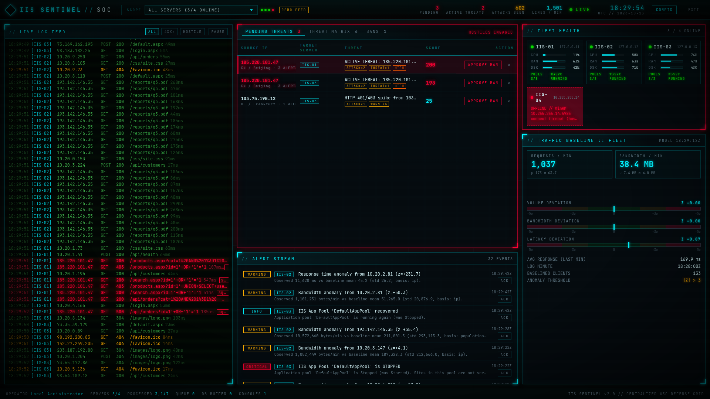
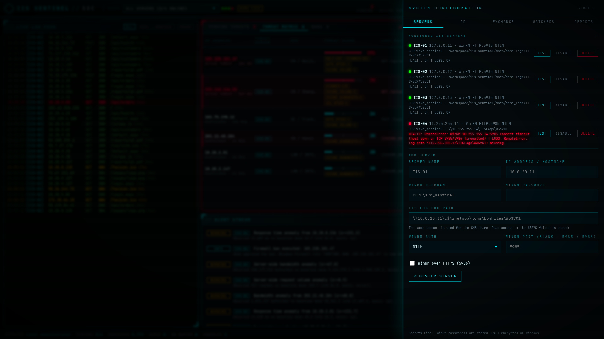
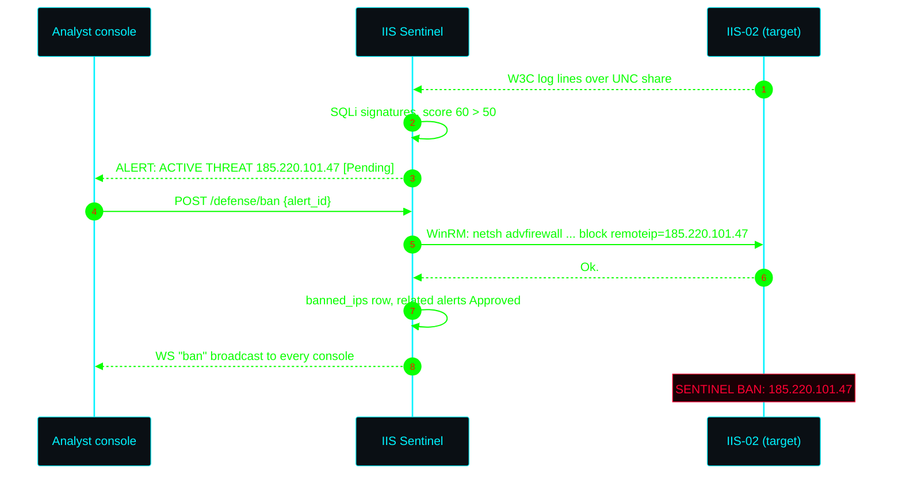
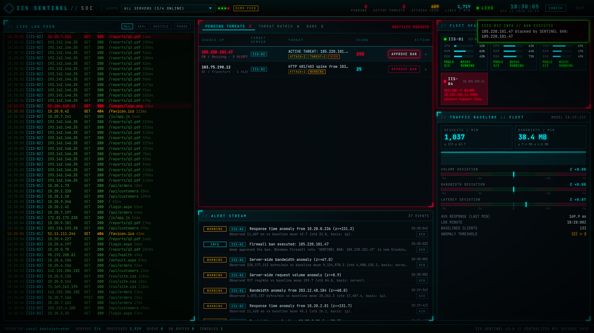
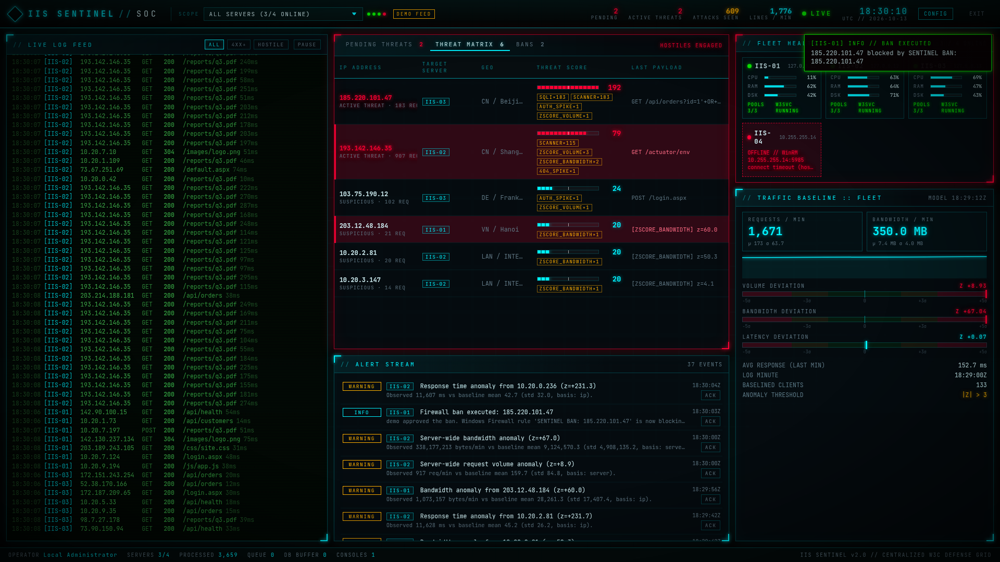
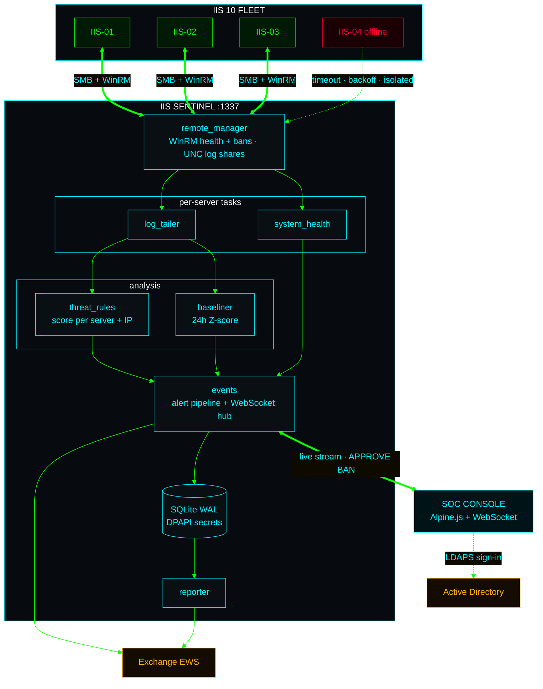
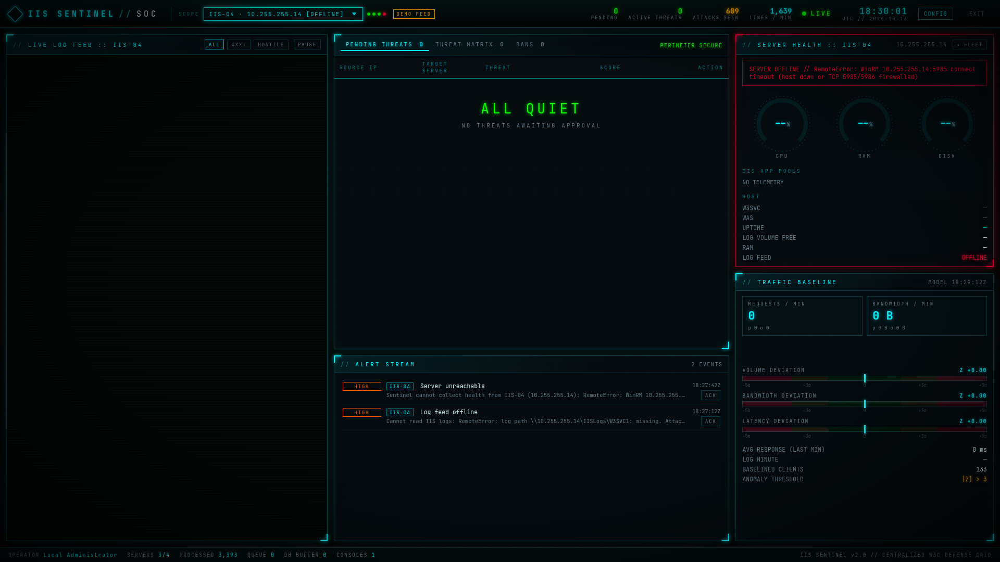
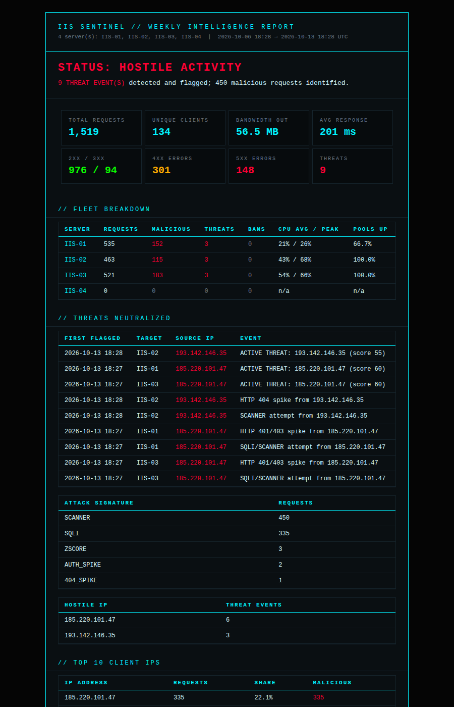

<div align="center">

```text
██╗██╗███████╗    ███████╗███████╗███╗   ██╗████████╗██╗███╗   ██╗███████╗██╗
██║██║██╔════╝    ██╔════╝██╔════╝████╗  ██║╚══██╔══╝██║████╗  ██║██╔════╝██║
██║██║███████╗    ███████╗█████╗  ██╔██╗ ██║   ██║   ██║██╔██╗ ██║█████╗  ██║
██║██║╚════██║    ╚════██║██╔══╝  ██║╚██╗██║   ██║   ██║██║╚██╗██║██╔══╝  ██║
     ██║██║███████║    ███████║███████╗██║ ╚████║   ██║   ██║██║ ╚████║███████╗███████╗
     ╚═╝╚═╝╚══════╝    ╚══════╝╚══════╝╚═╝  ╚═══╝   ╚═╝   ╚═╝╚═╝  ╚═══╝╚══════╝╚══════╝
          // CENTRALIZED SECURITY OPERATIONS CENTER FOR IIS 10 FLEETS //
```

**Real-time W3C log defense · fleet health · Z-score anomaly detection · operator-approved firewall bans**

[](#04-preparing-each-iis-server)
[](#run-from-source)
[](#07-architecture)
[](#02-quick-start)
[](../../actions/workflows/windows-installer.yml)
[](#05-active-defense)



</div>

---

## `//` TABLE OF CONTENTS

| | | |
| --- | --- | --- |
| [`01` What it is](#01-what-it-is) | [`05` Active defense](#05-active-defense) | [`09` API](#09-api) |
| [`02` Quick start](#02-quick-start) | [`06` Detection engine](#06-detection-engine) | [`10` Resilience](#10-resilience) |
| [`03` Installer](#03-windows-installer) | [`07` Architecture](#07-architecture) | [`11` Security model](#11-security-model) |
| [`04` Fleet onboarding](#04-preparing-each-iis-server) | [`08` Configuration](#08-configuration) | [`12` Building & CI](#12-building-the-installer) |

---

## `01` What it is

IIS Sentinel runs on a **Windows 10/11 admin workstation** (or any Windows server) and watches **any number of remote
IIS 10 servers at once**. Logs are tailed over each server's UNC share; health checks and bans go over WinRM.
Every server gets its own async tasks, so a server that drops off the network is logged, alerted on and retried with
backoff **while the rest of the fleet keeps streaming**.

<table>
<tr>
<td width="50%" valign="top">

### `▸` DETECT
- **Signatures:** SQL injection, XSS, path traversal / LFI, scanner user-agents (`sqlmap`, `nikto`, `nuclei`…)
- **Spikes:** 404 floods and 401/403 brute-force bursts
- **Directory enumeration:** 3+ different missing paths from one IP in 5 min, queued for ban with the probed URIs and WHOIS owner
- **Z-score anomalies** against a 24h baseline per IP, per server and per client population
- **Threat scoring** per *(server, attacker IP)* with half-life decay

</td>
<td width="50%" valign="top">

### `▸` MONITOR
- CPU / RAM / log-drive disk on every server over WinRM
- **App pool** and **W3SVC / WAS** state, with a CRITICAL alert the moment a pool stops
- Fleet health grid; offline servers are flagged red and never block the others
- Live WebSocket stream to every connected console

</td>
</tr>
<tr>
<td valign="top">

### `▸` RESPOND
- **PENDING THREATS** queue, grouped per attacker per target server
- **APPROVE BAN** opens a **BAN THREAT** dialog with WHOIS and a recommended CIDR (/32, /24 or /16, escalated from related attacks in the same subnet), or **BAN ALL** clears the whole queue
- **Range bans** go to Windows Firewall, the SonicWall group or both, with a **BANNED RANGES** panel and one-click UNBAN
- An **ALLOWLIST** that no ban, single IP or range, can ever overlap
- Perimeter bans on **SonicWall**, pfSense / OPNsense or Palo Alto, with SonicWall address-group management in the UI
- Ban history, one-click unban, dismiss without action
- **Live log search** (full-text, status / IP / URI / date filters) over everything Sentinel has stored
- Click any IP for **WHOIS / IP intel**: owner, network, abuse contact, reverse DNS, its request history, ban on any server
- Nothing is ever blocked automatically: a human always approves

</td>
<td valign="top">

### `▸` REPORT
- **ALERTS** tab: 43 events (threats, HTTP 5xx, slow responses, health, certificates, bans, logins…), each with its own desktop / email / severity
- Exchange (EWS) alert mail with retries, circuit breaker and an hourly cap
- Scheduled **weekly / monthly HTML reports** with a per-server fleet breakdown
- "All quiet" reports too, so silence never means "broken"
- Active Directory sign-in with an optional group gate

</td>
</tr>
</table>

---

## `02` Quick start

> [!TIP]
> No Windows box handy? **Demo mode** runs anywhere and simulates a four-server fleet, one of them offline.
>
> ```bash
> cd iis_sentinel && pip install -r requirements.txt
> SENTINEL_DEMO=1 python main.py        # → http://localhost:1337   login: demo / demo
> ```

| Path | Best for | Console |
| --- | --- | --- |
| **[Windows installer](#03-windows-installer)** | Production SOC workstation, unattended rollout | `http://127.0.0.1:1337` |
| **[From source](#run-from-source)** | Development, custom deployments | `http://localhost:1337` |
| **[Demo mode](#demo-mode)** | Kicking the tyres on any OS | `http://localhost:1337` |

The console listens on **port `1337`** by default. Override it with the installer's `/PORT=` option or the
`SENTINEL_PORT` environment variable.

---

## `03` Windows installer

`IISSentinel-Setup-2.0.0.exe` is **fully self-contained**: it ships its own Python 3.12 runtime and every dependency.
Requirements: Windows 10/11 or Server 2016+, x64, administrator rights. Nothing else.

```text
┌─ SETUP WIZARD ───────────────────────────────────────────────────────────────┐
│  Console port ............ 1337                                              │
│  Break-glass account ..... sentinel-admin                                    │
│  Break-glass password .... ************   (salted PBKDF2 hash, never plain)  │
│  Network access .......... [ ] allow other computers (opens Windows Firewall)│
└──────────────────────────────────────────────────────────────────────────────┘
```

**What you get:**

- **Program files:** `C:\Program Files\IIS Sentinel`.
- **Windows service:** **IIS Sentinel SOC**. It starts automatically (delayed) and restarts itself if it crashes. Setup waits until the console answers, then offers to open it.
- **Data, settings, reports and logs:** `%ProgramData%\IIS Sentinel`, readable only by **SYSTEM + Administrators**.
- **Network:** local-only (`127.0.0.1`) by default. Remote access listens on all interfaces and adds a Domain/Private firewall rule.
- **Start menu:** `Console`, `Reset Break-glass Password`, `Data and Logs` and `Uninstall`.

<details>
<summary><b>Unattended install / upgrade / uninstall</b></summary>

```powershell
# install or upgrade
IISSentinel-Setup-2.0.0.exe /VERYSILENT /SUPPRESSMSGBOXES /NORESTART `
    /ADMINPASSWORD="<pw>" [/ADMINUSER=soc-admin] [/PORT=1337] [/REMOTEACCESS=1] [/LOG=setup.log]

# uninstall (keeps the data folder unless /PURGEDATA is given)
& "C:\Program Files\IIS Sentinel\unins000.exe" /VERYSILENT [/PURGEDATA]

# rotate the break-glass password (self-elevating, prompts twice)
& "C:\Program Files\IIS Sentinel\reset-password.cmd"
```

- **Upgrades:** stop the service, replace the program files, then restart with your previous port, account and network choice. Leave the password empty to keep the current one. The data folder is never touched.
- **Uninstall:** removes the service and the console firewall rule. Firewall bans already pushed to IIS servers are left in place on purpose.

</details>

<details>
<summary><b>Troubleshooting</b></summary>

> [!IMPORTANT]
> The file to run is **`dist\IISSentinel-Setup-2.0.0.exe`** (`build.ps1` opens Explorer on it). It is a normal
> windowed setup wizard. A console window that flashes and vanishes means a *helper* program was started instead,
> such as the WinSW service wrapper (`service\IISSentinelService.exe`) or `python.exe`. Those programs are only
> ever started by Windows or by setup, and nothing under `installer\build\` is meant to be run.

| Symptom | Check |
| --- | --- |
| Wizard never appears | Run the setup `.exe` from `dist\` and accept the UAC prompt. Setup writes a log to `%TEMP%\Setup Log *.txt` |
| Console doesn't answer | `Get-Service IISSentinel`, then `%ProgramData%\IIS Sentinel\sentinel.log` and `service-logs\` |
| Need the full install log | Re-run the setup with `/LOG="%USERPROFILE%\Desktop\sentinel-setup.log"` |
| Port already in use | Re-run the setup and pick another port, or `/PORT=<port>` |

</details>

---

## `04` Preparing each IIS server

Open **CONFIG → SERVERS** and register each box: a name (`IIS-01`), its IP, WinRM credentials, and the UNC path of
its log folder. Press **TEST** to check WinRM and the share; it lists every site folder it found, with IIS site names.
Use **EDIT** on any server to change its address, credentials (a blank password keeps the stored one), log path or
start mode; monitoring restarts with the new settings.

**Every site on the server:** point the log path at the parent folder
(`\\10.0.20.11\c$\inetpub\logs\LogFiles`) and Sentinel tails every `W3SVC1`, `W3SVC2`, … folder below it. Sites
created later are picked up automatically (rescan every 60 s) and announced with a "New IIS site" alert. Each log line
and alert is tagged with the site's friendly name (`Portal (W3SVC2)`). Pointing at a single `W3SVC` folder still works.

**How much history to read** (per server, and under WATCHERS for local folders), applied to each site's current log
the first time Sentinel sees it:

| Start mode | Behaviour |
| --- | --- |
| New lines only | Start at the end of the file, follow new lines |
| Last N lines | Read the last *N* lines (you choose N), then follow |
| Whole file | Read the entire current log, then follow |

Sentinel then remembers its position in each file, so a restart resumes exactly where it stopped. Changing the mode
re-reads using the new setting. History is analysed and recorded, but it never fires notifications (see the live
window under ALERTS).

| Requirement | Details |
| --- | --- |
| **WinRM** | `winrm quickconfig` (HTTP 5985) or an HTTPS listener on 5986. NTLM, Kerberos and CredSSP are supported; Basic only over HTTPS. NTLM works by IP from anywhere. Kerberos needs a domain-joined workstation and DNS names (`pip install "pywinrm[kerberos,credssp]"`). |
| **Rights** | The account runs `Get-CimInstance`, `Get-IISAppPool` (IISAdministration / WebAdministration) and `netsh advfirewall`. In practice that means local Administrators on the IIS server. |
| **Log share** | Read access to the `W3SVC*` folder. Sentinel maps it with `WNetAddConnection2`, so no password appears on a command line. |
| **Log fields** | Enable **sc-bytes** and **cs-bytes** (IIS Manager → Logging → Select Fields) for bandwidth baselining. Field order is read from each file's `#Fields:` header. |

> [!NOTE]
> Running Sentinel *on* an IIS box? Add the local log folders under **WATCHERS → Local IIS log directories** (or set
> `SENTINEL_LOG_DIRS`). The host then appears as an extra server next to the remote ones.

<p align="center">
  
</p>

---

## `05` Active defense

Attack signatures, spikes and **ACTIVE THREAT** escalations create *actionable* alerts with status
.
They land in the **PENDING THREATS** panel, one row per attacker per target server. **APPROVE BAN** sends the ban to
*that* server (or to a perimeter firewall, see below):



```text
netsh advfirewall firewall add rule name="SENTINEL BAN: <ip>" dir=in action=block remoteip=<ip>
```

- **Strict IP validation:** loopback, unspecified and multicast addresses are refused, as is anything that isn't a literal IP.
- **Idempotent:** the rule is only added if it doesn't already exist, and approving the same alert twice returns `409`.
- **Clears the queue:** every other Pending alert from that attacker on that server becomes .
- **BAN ALL:** the big red button above the queue bans every pending attacker in one go, after a confirmation
  ("You are about to ban X IPs across Y servers"). Each IP is banned once (once per server with Windows Firewall);
  failures stay in the queue and are listed in a toast.
- **Reversible:** **BANS → UNBAN** (`DELETE /defense/bans/{id}`) deletes the firewall rule. Alerts can also be  without action.

### CIDR range bans (BAN THREAT dialog)

**APPROVE BAN** opens **BAN THREAT: &lt;ip&gt;**. On open it calls `GET /intel/recommend-cidr` and shows:

- **WHOIS:** org, ASN, country and abuse contact. If the lookup fails, the dialog shows "No WHOIS data available" and the ban still works.
- **The recommended range and why.** Escalation counts the *other* attacking IPs that hit any server in the same subnet:
  pending or handled attack/threat alerts plus existing single-IP and range bans from the last 24 h.

| Recommendation | When | IPv6 equivalent |
| --- | --- | --- |
| `/32` single IP | Only this IP has attacked, or the address is private/reserved | `/128` |
| `/24` subnet | 2+ other attackers from the same /24 within **1 hour** | `/64` |
| `/16` large subnet | 3+ other attackers from the same /16 within **24 hours**, some outside this /24 | `/48` |

A ban is never wider than `/16` (IPv6 `/32`). All math uses Python's `ipaddress`; CIDRs are never built from strings.

- **Scope radios:** Single IP / Subnet / Large Subnet. The recommended one is marked, and any scope that overlaps an allowlist
  entry or contains a monitored server's address is disabled with the reason.
- **Target radios:** Windows Firewall (netsh on the alert's server), SonicWall Group (the configured default group), or Both.
  Unconfigured targets are disabled.

**CONFIRM BAN** posts `/defense/ban-range`:

```text
netsh advfirewall firewall add rule name="SENTINEL BAN: <cidr>" dir=in action=block remoteip=<cidr>
SonicWall: address object SENTINEL_<net>_<prefix> added to the default group, then committed
```

- Every Pending alert from an IP inside the range is Approved.
- Every console gets a glowing red `[SENTINEL] RANGE BANNED: <cidr> (<scope>) — <reason>` banner above the live log feed.
- The range appears in **BANNED RANGES** (right column).
- If one target fails under "Both", the ban is kept for the target that worked and the failure is shown. **UNBAN**
  (`DELETE /banned-ranges/{id}`) then removes exactly what was applied.
- The SonicWall API path is IPv4 only. IPv6 ranges can go to Windows Firewall.

**Allowlist** (CONFIG → ALLOWLIST or the button on BANNED RANGES): addresses and ranges Sentinel must never block.
The check uses network overlap, so a `/16` that merely contains an allowlisted `/32` is refused with
`CIDR overlaps with allowlist entry`. Single-IP bans are checked too.

### Where the ban goes: CONFIG → FIREWALL

Pick one provider with the radio buttons. The setup steps for each one are shown in the tab.

| Provider | What APPROVE BAN does | Scope |
| --- | --- | --- |
| **Windows Firewall (on server)** | The `netsh` rule above, pushed over WinRM (the default) | The attacked server |
| **pfSense / OPNsense** | Adds the IP to a Host alias referenced by your block rule. OPNsense uses its built-in API (key + secret); pfSense needs the `pfSense-pkg-RESTAPI` v2 package and applies the filter after the change | Every server |
| **SonicWall** | SonicOS 7 API: creates address object `SENTINEL_<ip>`, adds it to your deny-rule address group, then commits | Every server |
| **Palo Alto** | PAN-OS User-ID XML API: tags the IP (default `sentinel-ban`). A Dynamic Address Group in your deny rule matches the tag. No commit is needed, and bans can auto-expire | Every server |

- **Your rules stay yours:** Sentinel only adds and removes addresses. You create the alias, group or Dynamic Address Group and the block rule once.
- **One approval clears every server:** a perimeter ban resolves that attacker's pending threats on every server.
- **LIFT removes the right entry:** each ban remembers which provider made it, so LIFT works even after you switch providers.
- **Credentials are encrypted:** firewall credentials are stored DPAPI-encrypted, like the Exchange password.
- **Test before you rely on it:** **TEST CONNECTION** checks the settings on screen (before you save them): credentials
  and that the alias or group exists. The result is shown as a toast.
- **Belt and braces:** tick *Also add the Windows Firewall rule* to push the `netsh` rule to the attacked server as
  well as the perimeter block. LIFT removes both.

#### SonicWall

- **HTTP or HTTPS:** the *SonicWall API URL* is used exactly as typed (`http://192.168.168.168` or `https://fw:4433`).
  It is never upgraded to HTTPS. TLS certificate verification is **off**, so the factory self-signed certificate works.
- **One admin session at a time:** SonicOS allows a single config session, so Sentinel queues its API calls. A BAN ALL of 50
  IPs never kicks itself out, and every ban PUTs the complete member list (SonicOS replaces members on PUT).
- **Group management:** the *Address groups* table in **CONFIG → FIREWALL** lists every IPv4 group on the box with its members.
  You can create a group, make it the default ban group (**USE**) or delete it. The current default group can't be deleted.
  Deleting a group also removes its `SENTINEL_*` address objects.
- **Hosts and networks:** `POST /firewall/groups/{name}/members` takes a host (`203.0.113.7`) or a CIDR (`203.0.113.0/24`),
  which becomes a network object.
- **Commit, then verify:** every change is committed (`/config/pending`) and then verified, because SonicOS 7.3 reads return
  committed configuration.
- **Errors:** wrong credentials, a missing group and HTTP 429 rate limiting each get a clear error. A 429 is retried
  automatically, honouring `Retry-After`.
- **Open the settings:** the **Perimeter Firewall** card in the right-hand panel shows where bans go and opens
  **FIREWALL SETTINGS**.

### Locations in the threat matrix

The GEO column comes from a local GeoIP database. On first start, Sentinel downloads the free DB-IP *IP to City Lite*
database (CC BY 4.0, about 130 MB, no account needed) into `data\geoip\` and refreshes it monthly. A MaxMind
`GeoLite2-City.mmdb` placed in that folder takes precedence. On a host without internet access, Sentinel shows the
WHOIS registry country instead. You can turn the download off under **WATCHERS**.

<table>
<tr>
<td width="50%"></td>
<td width="50%"></td>
</tr>
<tr>
<td align="center"><sub><b>APPROVE BAN</b>: rule pushed to the target server</sub></td>
<td align="center"><sub><b>THREAT MATRIX</b>: scores per (server, IP)</sub></td>
</tr>
</table>

---

### Alerts and notifications

**CONFIG → ALERTS** lists every event Sentinel can raise. For each one, choose whether it is recorded (**ON**),
shown as a toast and desktop pop-up (**DESKTOP**), emailed through Exchange (**EMAIL**), and at what severity.

| Group | Events |
| --- | --- |
| Threats | active threat (required: it feeds the ban queue), SQLi, XSS, traversal, scanner, 404 flood, directory enumeration (404 scan), auth brute force, threat cleared |
| HTTP | server errors (HTTP 500-599, configurable, rolled up per URL), error bursts per site, watched codes (e.g. 413/429), slow responses, traffic / latency anomalies, traffic drop |
| Health | server unreachable / recovered, log feed offline / restored, new site, site stopped / started, app pool stopped / recovered / removed, W3SVC down / recovered, CPU, RAM, disk, TLS certificate expiring |
| Defense | ban executed, ban failed, ban lifted |
| Sentinel | break-glass login, login lockout / failure / success, configuration changed, server added / edited / removed, report failed, Sentinel started |

The same tab also has:

- **Delivery:** email recipients, which override the Exchange alert list.
- **Test:** desktop and email test buttons.
- **HTTP detection:** HTTP detection thresholds, plus URL prefixes to ignore (health checks, SignalR).
- **Timing:** certificate warning days, and quiet hours (CRITICAL can bypass).
- **Muting:** muted servers, for maintenance windows.

Desktop pop-ups need the browser's permission and a secure context: `https://` or `http://localhost`. Over plain
HTTP from another machine, in-page toasts and the alert tone still work.

---

## `06` Detection engine

| Signal | Points | Trigger |
| --- | :---: | --- |
| SQL injection | **+10** | `UNION SELECT`, tautologies, stacked queries, time-based blind… |
| Cross-site scripting | **+10** | `<script>`, event handlers, `javascript:` URIs |
| Path traversal / LFI | **+10** | `../`, encoded variants, `/etc/passwd`, `win.ini` |
| Scanner user-agent | **+5** | `sqlmap`, `nikto`, `nuclei`, `acunetix`, `masscan`… |
| 404 spike | **+5** | ≥ `spike_404_threshold` 404s from one IP inside the spike window |
| Directory enumeration | **+5** | ≥ `enum_404_threshold` (3) **different** 404 paths from one IP within `enum_404_window_minutes` (5). It raises a Pending *Directory Enumeration (404 Scan)* alert with the URIs and the WHOIS owner. `favicon.ico`, `robots.txt`, `apple-touch-icon*`, `sitemap*.xml` and `/.well-known/*` are ignored. The counters are saved to the database every 60 s, so a restart doesn't reset a scan in progress |
| 401 / 403 spike | **+5** | ≥ `spike_auth_threshold` auth failures from one IP |
| Z-score anomaly | **+20** | Requests/min or bandwidth/min with Z > 3.0 against the IP's 24h baseline |

```text
 score ──▶  0 ─────── 10 ─────────────── 50 ──────────────────────────▶
            WATCH     SUSPICIOUS         ACTIVE THREAT  (HIGH alert, emailed, queued for ban approval)
```

- Payloads are URL- and HTML-entity-decoded up to **three times** before matching, which defeats double encoding.
- Scores are tracked per **(server, source IP)** and decay with a configurable half-life (default 30 min).
- Baselines learn **only from clean traffic**, so attackers can't poison the model.
- Each server keeps its own per-minute bucket, because every IIS box flushes its log buffer on its own schedule.

| Severity | Meaning |
| --- | --- |
|  | App pool stopped, W3SVC down, disk below the free-space floor |
|  | Active threat, server unreachable, log feed offline |
|  | Traffic, bandwidth or latency anomaly; CPU / RAM over threshold |
|  | Recoveries, executed bans, configuration events |

---

## `07` Architecture



```text
iis_sentinel/
├── main.py            FastAPI app · REST API · /ws/dashboard · task supervisor · processing pipeline
├── remote_manager.py  WinRM health (CIM + IISAdministration) · UNC log tailing · netsh firewall bans
├── log_tailer.py      one tail task per server · rolling W3C parser (rollover, truncation, #Fields aware)
├── system_health.py   one health task per server · app pool / W3SVC / disk / CPU alerts · offline detection
├── baseliner.py       24h statistical baseline (per server / per IP / population) · Z-score anomalies
├── threat_rules.py    SQLi / XSS / traversal / scanner signatures · 404 + 401/403 spikes · dir enumeration · scores
├── firewall.py        ban providers: Windows (netsh) · pfSense / OPNsense · SonicWall · Palo Alto
├── sonicwall_api.py   async SonicOS 7 client (httpx, http or https, no TLS verify): groups, objects, commit
├── database.py        async SQLAlchemy (SQLite WAL) · server registry · DPAPI-protected config store
├── events.py          WebSocket fan-out hub · alert pipeline (persist → broadcast → email)
├── ad_auth.py         Active Directory bind (LDAPS / StartTLS, nested-group gate) · break-glass login
├── local_admin.py     break-glass account stored as a salted PBKDF2-SHA256 hash
├── sentinelctl.py     admin CLI: set-admin-password · show-admin · run
├── mailer.py          exchangelib delivery · retries · timeouts · circuit breaker · rate limit
├── reporter.py        weekly / monthly HTML reports with a per-server fleet breakdown
└── static/            index.html (login) · dashboard.html (SOC) · css/style.css · js/app.js
installer/
├── build.ps1          builds the self-contained setup .exe (embedded CPython + WinSW + Inno Setup)
├── IISSentinel.iss    wizard, service, firewall, ACLs, upgrade + uninstall logic
├── reset-password.cmd self-elevating break-glass reset
└── tests/e2e.ps1      Windows end-to-end test (CI only: it reconfigures the host)
```

---

## `08` Configuration

### Run from source

```powershell
cd iis_sentinel
py -3.12 -m venv .venv
.venv\Scripts\pip install -r requirements.txt
.venv\Scripts\python sentinelctl.py set-admin-password      # break-glass account (hashed)
.venv\Scripts\python main.py                                # → http://localhost:1337
```

Sign in as `sentinel-admin`, open **CONFIG** and fill in **SERVERS**, **AD**, **EXCHANGE**, **WATCHERS** and
**REPORTS**. Once AD is configured, analysts sign in with their domain credentials. The break-glass account keeps
working when AD is down.

### Demo mode

```bash
SENTINEL_DEMO=1 python main.py        # http://localhost:1337  (demo / demo)
```

Demo mode seeds four servers:

- **`IIS-01`..`IIS-03`** (127.0.0.11-13) are simulated. A generator writes real W3C files into `data/demo_logs/<server>/W3SVC1`, so the tailer, parser, threat engine, baseliner, database and WebSocket all run for real.
- **`IIS-04`** (10.255.255.14) is a real, unreachable address. It shows how an offline server is reported while the others keep streaming.

Set `SENTINEL_DEMO_ROLLOVER_SECONDS=120` to force frequent log rollovers.

<p align="center">
  
</p>

<details>
<summary><b>Environment variables</b></summary>

| Variable | Purpose |
| --- | --- |
| `SENTINEL_HOST` / `SENTINEL_PORT` | Bind address. Default **`0.0.0.0:1337`** from source; the installer writes `127.0.0.1` or `0.0.0.0` and your chosen port into the service. |
| `SENTINEL_SSL_CERT` / `SENTINEL_SSL_KEY` | Serve HTTPS directly (then set `SENTINEL_COOKIE_SECURE=1`) |
| `SENTINEL_LOCAL_ADMIN_USER` / `SENTINEL_LOCAL_ADMIN_PASSWORD` | Plain-text break-glass login for development; overrides `local_admin.json` |
| `SENTINEL_LOG_DIRS` | Local IIS log directories (`;`-separated) when Sentinel runs on an IIS server |
| `SENTINEL_AD_SERVERS`, `SENTINEL_AD_DOMAIN`, `SENTINEL_AD_UPN_SUFFIX`, `SENTINEL_AD_BASE_DN`, `SENTINEL_AD_GROUP` | Initial AD settings |
| `SENTINEL_DATA_DIR` | SQLite DB, `local_admin.json` and rotating `sentinel.log` (default `./data`; installer: `%ProgramData%\IIS Sentinel`) |
| `SENTINEL_SECRET_KEY` | Session signing key (default: random, stored DPAPI-protected in the DB) |
| `SENTINEL_SESSION_HOURS` | Session lifetime (default 12) |
| `SENTINEL_LOG_LEVEL` | `DEBUG` / `INFO` / `WARNING` (default `INFO`) |
| `SENTINEL_DEMO=1` | Demo mode: simulated four-server fleet with synthetic traffic and attacks; login `demo` / `demo` |

</details>

---

## `09` API

Every log line, health sample, threat and alert pushed over the WebSocket carries `server_id` and `server_name`.

<details>
<summary><b>REST + WebSocket reference</b></summary>

| Method | Path | Description |
| --- | --- | --- |
| `POST` | `/login` | `{username, password}`: AD or break-glass sign-in; sets an HttpOnly session cookie |
| `POST` | `/logout` | End the session |
| `GET` | `/healthz` | Liveness, uptime and background-task status (no auth) |
| `GET` | `/servers` | Monitored servers (passwords masked), connectivity, latest health, log tailer status |
| `POST` | `/servers` | `{server_name, ip_address, winrm_username, winrm_password, log_unc_path, log_start_mode?, log_tail_lines?, winrm_transport?, winrm_port?, winrm_use_ssl?, winrm_verify_ssl?}` |
| `PUT` / `DELETE` | `/servers/{id}` | Update (a blank password keeps the stored one) / remove |
| `POST` | `/servers/{id}/test` | Check WinRM and the log share without consuming log lines |
| `POST` | `/defense/ban` | `{alert_id}` (or `{server_id, ip}`): firewall ban on the alert's server; the alert becomes `Approved` |
| `POST` | `/defense/dismiss` | `{alert_id}`: the alert becomes `Dismissed` |
| `GET` / `DELETE` | `/defense/bans`, `/defense/bans/{id}` | Active bans / lift a ban |
| `GET` / `POST` | `/config` | `ad`, `exchange`, `watchers`, `reports`, `alerts`, `firewall` sections (secrets masked) |
| `GET` | `/alerts/catalog` | Every notifiable event with its defaults, plus Exchange delivery status |
| `POST` | `/alerts/test` | `{desktop, email, severity}`: raise a test notification and optionally send a test email |
| `GET` | `/threats/whois/{ip}?refresh=` | RDAP WHOIS + reverse DNS (cached 6 h), active bans and alert count for an IP |
| `POST` | `/config/test/exchange` | Send a test mail |
| `POST` | `/defense/ban-all` | `{alert_ids: [...]}`: ban every attacker behind those Pending alerts. Returns `{banned, failed, skipped, alert_ids, ip_count, server_count}` |
| `GET` | `/intel/recommend-cidr?ip=&server_id=` | Escalation recommendation `{recommended_cidr, scope, reason, attack_count, attacker_ips, options[]}` plus WHOIS (or `whois_error`), allowlist hits, ready targets |
| `POST` | `/defense/ban-range` | `{alert_id}` (or `{ip, server_id}`), optional `scope` (`/32` `/24` `/16`, `single` `subnet` `large`) and `firewall_target` (`windows` `sonicwall` `both`). Defaults: recommended scope, configured target. `409` on allowlist/self-ban overlap |
| `GET` / `DELETE` | `/banned-ranges?active=&page=&page_size=`, `/banned-ranges/{id}` | Range bans, newest first / lift (removes the netsh rule and/or SonicWall member) |
| `GET` / `POST` / `DELETE` | `/allowlist`, `/allowlist/{id}` | Allowlist entries / add `{ip_or_cidr, description}` / remove |
| `GET` / `POST` | `/firewall`, `/firewall/test` | Active ban provider / test a connection (`{provider, settings?}`: unsaved form values; a masked secret keeps the saved one) |
| `GET` / `POST` | `/firewall/config` | `{firewall_type, api_url, username, api_key, default_group_name, zone, also_windows}` (secret masked). Saved in the `firewall` config section |
| `GET` / `POST` / `DELETE` | `/firewall/groups` (`DELETE ?name=`) | SonicWall IPv4 address groups with resolved members / create `{name, description}` / delete |
| `POST` / `DELETE` | `/firewall/groups/{name}/members` (`DELETE ?address=`) | Add / remove a host or CIDR (`SENTINEL_*` object) and commit |
| `GET` | `/logs/search` | `q` (free text plus `ip:` `status:` `uri:` `method:` `server:` tokens), `status=all\|4xx\|5xx\|404\|<code>`, `ip`, `uri`, `server_id`, `since`, `until` (ISO, UTC), `page`, `page_size` (≤ 200) |
| `GET` | `/geoip` | GeoIP database in use |
| `GET` | `/threats/live` | Recent malicious requests plus threat and anomaly alerts |
| `GET` | `/threats/active?server_id=` | Threat matrix (scored server/IP pairs) |
| `GET` | `/threats/ip/{ip}?server_id=` | Threat state and recent requests for one IP |
| `GET` | `/system/health?server_id=` | Latest CPU / RAM / disk / app pool / W3SVC sample per server |
| `GET` | `/stats/baseline?server_id=` | Baseline model, pipeline and watcher status |
| `GET` / `POST` | `/alerts?server_id=&status=&severity=`, `/alerts/{id}/ack` | Alert history / acknowledge |
| `GET` / `POST` | `/reports`, `/reports/run`, `/reports/{id}/html` | Report history, run now, view HTML |
| `WS` | `/ws/dashboard` | `hello` `logs` `health` `servers` `server_status` `threats` `alert` `ban` `alert_status` `range_ban_notification` (`{cidr, scope, reason, firewall_target}`) `range_unban` `allowlist` `baseline` `tick` |

</details>

---

## `10` Resilience

> **Design rule:** an unreachable IIS server, Exchange server or domain controller must never take the SOC down.

- **Per-server isolation.** Each server has its own log task and health task.
  - **Failures:** WinRM timeouts, refused connections, bad credentials and unreachable shares.
  - **Backoff:** each server backs off independently (logs up to 60 s, health up to 10 min).
  - **Alerts:** one HIGH alert when a server or its log feed goes down, then an INFO alert when it recovers.
- **No pile-ups.** Remote calls run in worker threads with hard timeouts. A hung WinRM call is never duplicated.
  Concurrent health reads share a single in-flight call, so a dead server can't exhaust the thread pool.
- **Supervised tasks.** Every background task restarts with exponential backoff if it crashes. Per-server tasks are
  reconciled every 5 s, and immediately when servers are added, edited or removed.
- **Graceful dependencies.**
  - **AD and Exchange:** calls have hard timeouts and return errors instead of raising.
  - **Exchange mail:** has retries, a circuit breaker and an hourly cap.
  - **Reports:** always recorded in the database, even when delivery fails.
- **Durable storage.** SQLite runs in WAL mode with busy timeouts and lock retries.
  - **Batched writes:** log lines are written in batches of 500 or every 5 s, whichever comes first. A batch that still
    hits a lock after the retries is put back and written with the next one.
  - **Instant live view:** the live view never waits for the database. An in-memory ring buffer feeds the WebSocket
    every 0.3 s.
  - **Migrations:** older databases are migrated in place.
- **Full-text log search.** An SQLite FTS5 index covers URI, query string, user agent, client IP, method and user,
  and triggers keep it in sync with every insert and purge.
  - **Upgrades:** rows written before the upgrade are indexed in the background, in small chunks.
  - **No FTS5:** on SQLite builds without FTS5, search falls back to `LIKE` matching.
  - **In the dashboard:** the search bar above the live feed (300 ms debounce) switches the feed to paged **SEARCH RESULTS**.
    **CLEAR SEARCH / LIVE MODE** goes back to the live stream.
- **Log rotation is never blocked.** Log files are opened per read, never held open.

---

## `11` Security model

| Asset | Protection |
| --- | --- |
| WinRM passwords, Exchange password, session key | **DPAPI**-encrypted at rest (machine scope) and never returned by the API |
| Data directory | ACL restricted to **SYSTEM + Administrators**, because DPAPI machine scope means any local reader could decrypt |
| Break-glass password | Salted **PBKDF2-SHA256** hash (310,000 iterations). Never on a command line, in the registry or in the service config |
| Sessions | HMAC-signed, HttpOnly, `SameSite=Strict` cookies with server-side revocation |
| State-changing API | Same-origin check on every mutating endpoint; login is throttled per IP and per user |
| Bans | Literal-IP validation before anything reaches `netsh`; nothing is ever banned without operator approval |

> [!WARNING]
> The console speaks plain HTTP unless you set `SENTINEL_SSL_CERT` / `SENTINEL_SSL_KEY`. Keep the default local-only
> binding, or put it behind TLS, before letting other analysts in over the network.

---

## `12` Building the installer

On any Windows 10/11 machine with PowerShell 5.1+ and internet access:

```powershell
powershell -ExecutionPolicy Bypass -File installer\build.ps1 -Version 2.0.0
# → dist\IISSentinel-Setup-2.0.0.exe  (+ .sha256), selected in Explorer when the build finishes
```

Run **`dist\IISSentinel-Setup-2.0.0.exe`** to install. `installer\build\` only holds intermediate files.

`build.ps1` does the following:

1. Downloads the CPython embeddable zip and WinSW, checked against **pinned SHA-256** hashes.
2. Installs `requirements.txt` into the embedded runtime.
3. Smoke-tests every import plus a DPAPI round trip.
4. Compiles `installer\IISSentinel.iss` with Inno Setup 6, installing it via winget or Chocolatey if missing.

The **[Windows installer workflow](../../actions/workflows/windows-installer.yml)** builds the installer on fresh
Windows Server 2022 and 2025 runners (the Windows 10 and Windows 11 code bases), plus an upgrade from the previous install layout, then runs `installer\tests\e2e.ps1`. That test:

```text
[PASS] install IIS 10 · lab WinRM account · SMB log share
[PASS] silent install · service running as LocalSystem · firewall rule · shortcuts
[PASS] PBKDF2-only password at rest · data dir ACL = SYSTEM + Administrators
[PASS] break-glass login · wrong password → 401
[PASS] register IIS-LAB over WinRM/NTLM + UNC · TEST · live health with app pools
[PASS] real SQLi + sqlmap traffic → ACTIVE THREAT → APPROVE BAN → netsh rule → unban
[PASS] unreachable server added → every task alive, IIS-LAB still online
[PASS] service restart · silent upgrade keeps settings · password rotation
[PASS] silent uninstall /PURGEDATA → service, files, firewall rule and data gone
```

> [!CAUTION]
> `e2e.ps1` installs IIS, creates a local administrator and enables PS Remoting. Run it only on throwaway VMs or CI runners.

---

<div align="center">



<sub>Weekly fleet report, delivered over Exchange</sub>

<br><br>

```text
 SENTINEL v2.0 // CENTRALIZED IIS DEFENSE GRID // ALL SYSTEMS NOMINAL ▮
```


</div>
